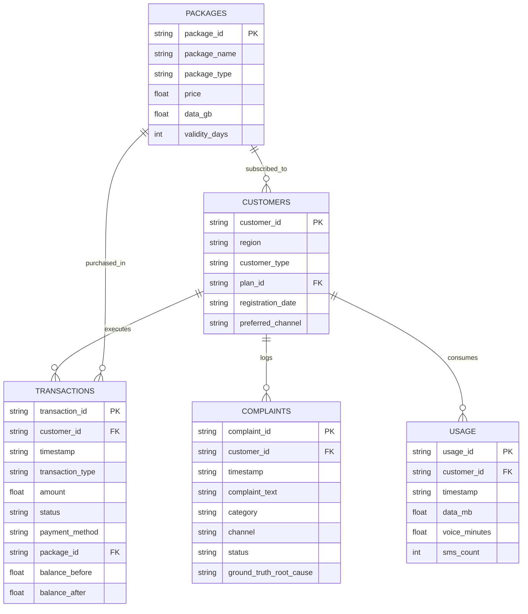

# 📊 Hutch Telecom Dataset Specification (`data/`)

> **Synthetic Telecom Multi-Source Dataset**
> *Created for the IgnitX Hackathon 2026 PoC development and testing.*

---

## 📁 Dataset Summary

| File Name | Record Count | Description | Primary Key | Join Foreign Keys |
| :--- | :--- | :--- | :--- | :--- |
| `complaints.csv` | **1,200** | Incoming customer complaint tickets | `complaint_id` | `customer_id` |
| `customers.csv` | **5,000** | Customer demographic & account profiles | `customer_id` | `plan_id` $\rightarrow$ `packages.package_id` |
| `transactions.csv` | **50,010** | Detailed transaction ledger records | `transaction_id` | `customer_id`, `package_id` |
| `usage.csv` | **30,000** | Metered usage logs (data, voice, SMS) | `usage_id` | `customer_id` |
| `packages.csv` | **8** | Active Hutch tariff package definitions | `package_id` | N/A |
| `data_dictionary.csv` | **28** | Field-level schema definitions | N/A | N/A |

---

## 🔗 Entity Relationship Model

---

## 📋 File Schema Details

### 1. `complaints.csv`
- `complaint_id`: Unique ticket identifier (e.g., `CP000001`).
- `customer_id`: Customer identifier (e.g., `C03619`).
- `timestamp`: Date and time ticket was logged.
- `complaint_text`: Raw complaint text reported by subscriber.
- `category`: Ticket classification (`Billing Dispute`, `Package`, `Recharge`, `Network`).
- `channel`: Reporting channel (`Call Center`, `Web`, `Mobile App`, `USSD`).
- `status`: Ticket status (`Investigating`, `Resolved`, `In Progress`).
- `ground_truth_root_cause`: Ground truth anomaly cause for rule engine validation.

### 2. `customers.csv`
- `customer_id`: Unique customer identifier (`C00001` to `C05000`).
- `region`: Subscriber location (`Northern`, `Central`, `North Central`, `Western`, `Southern`, `Sabaragamuwa`, `Uva`).
- `customer_type`: Subscription plan type (`Prepaid`, `Postpaid`).
- `plan_id`: Tariff plan ID matching `packages.csv`.
- `registration_date`: Subscriber activation date.
- `preferred_channel`: Contact channel preference.

### 3. `transactions.csv`
- `transaction_id`: Transaction reference (`T0000001` to `T0050010`).
- `customer_id`: Customer ID reference.
- `timestamp`: Exact transaction execution timestamp.
- `transaction_type`: Type of event (`Recharge`, `Refund`, `Package Purchase`, `Package Renewal`, `Bill Payment`).
- `amount`: Monetary value in `LKR`.
- `status`: Execution status (`Success`, `Failed`, `Pending`).
- `payment_method`: Gateway method (`Bank Transfer`, `Bank Card`, `Hutch App`, `USSD`).
- `package_id`: Associated package ID (if applicable).
- `balance_before` / `balance_after`: Account balance state before and after transaction.

### 4. `usage.csv`
- `usage_id`: Usage log reference (`US000001` to `US030000`).
- `customer_id`: Customer ID reference.
- `timestamp`: Usage timestamp.
- `data_mb`: Megabytes consumed during session.
- `voice_minutes`: Voice call minutes used.
- `sms_count`: SMS count sent.

### 5. `packages.csv`
- `package_id`: Package code (`Smart 599`, `Unlimited 999`, `Starter`, etc.).
- `package_name`: Marketing name (`Hutch Smart 599`, `Hutch Unlimited 999`).
- `package_type`: Service type (`Data`, `Combo`, `Voice`).
- `price`: Retail price in `LKR`.
- `data_gb`: Allocated high-speed data quota in GB.
- `validity_days`: Quota validity period.

---

## 🔒 Usage & Disclaimer

This dataset is synthetic and constructed strictly for prototype demonstration and testing. It contains no real Hutch PII (Personally Identifiable Information).
